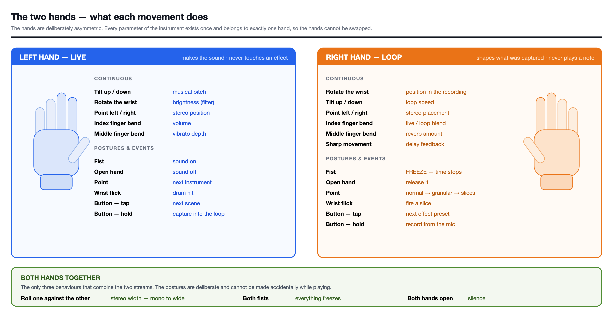
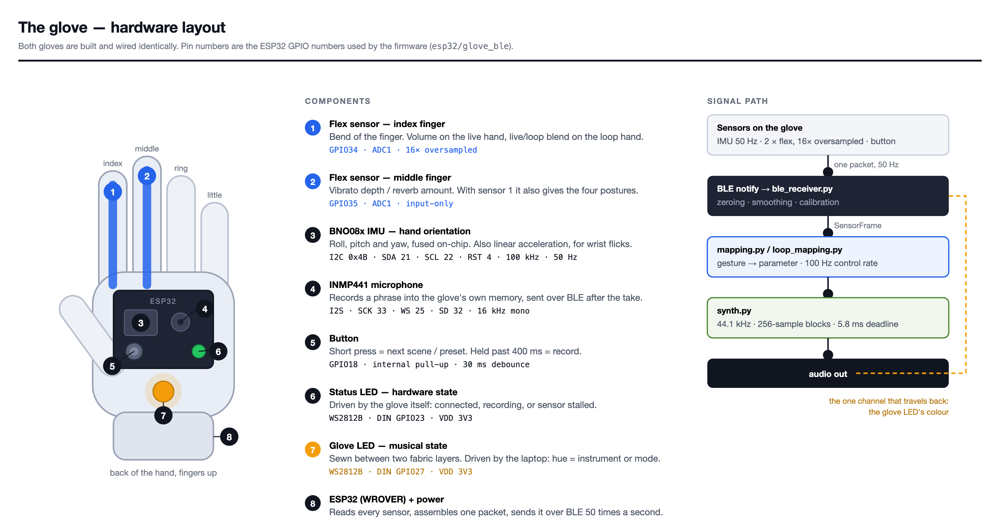

# MiMu-Style Gesture Gloves

A pair of gloves you play like an instrument. An ESP32 and a BNO08x motion
sensor on each hand stream movement over Bluetooth LE, and the laptop turns it
into sound with a real-time synthesizer written in Python and NumPy.



One hand makes the sound and the other shapes what you recorded. Each control
belongs to exactly one hand.

## Quick start

No gloves needed: the browser panel can play both hands.

```bash
python3 -m venv .venv
source .venv/bin/activate
pip install -r requirements.txt

python main.py --web    # browser panel
python main.py          # play with your keyboard
python main.py --demo   # scripted demo, just listen
```

With gloves:

```bash
python main.py --ble --voice-glove --web                      # four flex sensors
python main.py --ble --voice-glove --web --right-one-sensor   # one sensor on the right hand
```

Hold both hands still until the terminal says `glove calibrated — play!`.

## What each gesture does

| Gesture | Left hand: plays | Right hand: shapes the recording |
| --- | --- | --- |
| Tilt | Note, locked to the scale | Speed and pitch |
| Wrist rotation | Brightness | Position in the recording |
| Turn left/right | Stereo position | Stereo position |
| Index finger | Volume | Live/loop blend |
| Middle finger | Vibrato | Reverb |
| Fist | Sound on | Freeze |
| Open hand | Sound off | Release freeze |
| Point (index straight, middle bent) | Next instrument | Next loop mode |
| Wrist flick | Drum hit | Stutter, or a slice in Slices mode |
| Button tap | Next scene | Next preset |
| Button hold | Record | Record |

With both hands:

| Gesture | Effect |
| --- | --- |
| Rotate them in opposite directions | Stereo width |
| Two fists | Freeze |
| Two open hands | Instrument off, freeze released (recorded layers keep playing) |

## What you can do

- **Play seven instruments:** Saw, Organ, Strings, Bell, Flute, Pluck and
  Guitar. Six scenes switch instrument and scale together.
- **Record in layers:** mute, solo or delete each layer, and give it its own
  effects, shown as pills you can take off again.
- **Reshape a recording:** Granular, Slices, Harmony, Freeze and Reverse.
- **Design an instrument:** the Create tab has four engines and live audition.
- **Play a song:** load an audio file and work on it with your hands.
- **Play a tune:** a `.mid` file plays through your instruments.
- **Send MIDI to a DAW:** add `--midi`.
- **Save your work:** record the whole session, or export a loop.

```bash
python main.py --web --song track.mp3                 # an audio file
python main.py --web --song track.mp3 --song-start 60 --song-seconds 20
python main.py --web --melody tune.mid                # a MIDI file
python main.py --web --cover covers/ori-kheli.json    # our song, ready as layers
```

Downloading audio from YouTube is against its terms, so use a file you have the
right to use.

## Keyboard

These work while the browser panel is focused.

| Key | Action | Key | Action |
| --- | --- | --- | --- |
| `v` | Record | `g` | Granular |
| `o` | Add a layer | `b` | Slices |
| `p` | Loop on/off | `h` | Harmony |
| `a` | Bounce layers into one | `f` | Freeze |
| `s` | Record the session | `j` | Reverse |
| `e` | Export the loop | `k` | Pitch only |
| `n` | Next scene | `l` | Live voice |
| `m` | Instrument on/off | `c` | Recalibrate fingers |
| `space` | Drum hit | | |

Wear headphones when using `o` or `l`, or the speakers will leak into the mic.

## How it works

```
ESP32 + BNO08x ── Bluetooth LE, 50 Hz ──> ble_receiver.py ──┐
                                                            ├─> mapping ─> synth.py ─> speakers
keyboard / browser ─────────────────────> sensors, web ─────┘   100 Hz     44.1 kHz
```

| File | What it does |
| --- | --- |
| `main.py` | Starts everything and runs the control loop |
| `synth.py` | Instruments, filter, effects, looper and layers |
| `layerfx.py` | Effects applied to a single layer |
| `mapping.py`, `loop_mapping.py` | Turn gestures into sound settings, one file per hand |
| `ble_receiver.py`, `sensors.py`, `web_source.py` | Glove, keyboard and browser input |
| `instruments.py` | Designed instruments |
| `song.py`, `melody.py`, `cover.py`, `midi_out.py` | Songs, MIDI and backing layers |
| `ui.html` | Browser panel |
| `esp32/glove_ble/` | Glove firmware |

## Hardware



| Part | Pins |
| --- | --- |
| BNO08x | SDA→21, SCL→22, RST→4, ADD→3V3 (0x4B), PS0/PS1→GND |
| Flex sensors | GPIO34, GPIO35, each with 15k to GND |
| INMP441 mic | SCK→33, WS→25, SD→32, L/R→GND |
| Button | GPIO18→GND |
| Status LED (WS2812B) | DIN→23, VDD→3V3 |
| Glove LED (WS2812B) | DIN→27, VDD→3V3 |

Flash each board with its own hand. Replace `XXX` with your port:

```bash
# left hand
arduino-cli compile --upload -p /dev/cu.usbserial-XXX \
  --fqbn esp32:esp32:esp32:UploadSpeed=115200 esp32/glove_ble

# right hand
arduino-cli compile --upload -p /dev/cu.usbserial-XXX \
  --fqbn esp32:esp32:esp32:UploadSpeed=115200 \
  --build-property "compiler.cpp.extra_flags=-DHAND_VOICE" esp32/glove_ble
```

| Status LED | Meaning |
| --- | --- |
| Dim blue pulse | Waiting for the laptop |
| Dim green | Connected |
| Solid red | Recording |
| Blue blink | Sending a recording |
| Fast red blink | Sensor stalled |

## More

- [THREE-SENSORS.md](THREE-SENSORS.md): running with one sensor on the right hand
- [renewed-design.md](renewed-design.md): why the hands are shaped this way

## Libraries

NumPy, sounddevice, bleak, websockets, pyserial, python-rtmidi, mido, soundfile
and yt-dlp. On the glove: Adafruit BNO08x and the ESP32 Arduino core.
